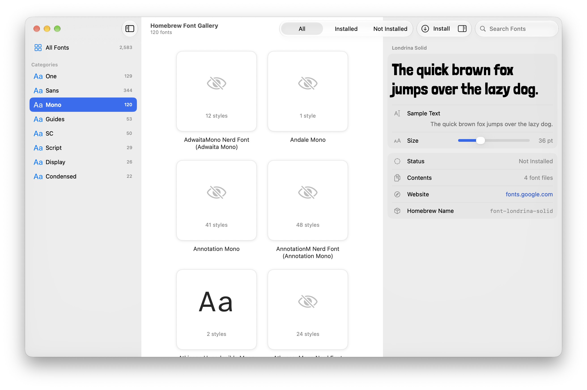

<p align="center">
  
</p>

<h1 align="center">Homebrew Fonts Gallery</h1>

A native Mac app for browsing, previewing and installing the fonts Homebrew offers.

<p align="center"></p>

## What it does

- Shows every `font-*` cask Homebrew knows about as a grid of thumbnails, with search, and sidebar filters for installed and not-installed fonts.
- Groups fonts into categories in the sidebar, by the most common last words of their names (Sans, Mono, Script and so on).
- Renders a live preview of each font with your own sample text, size and style.
- Installs and uninstalls fonts with one click by running `brew install --cask` and `brew uninstall --cask`.
- Shows cask details (version, homepage, description) from `brew info --json`.

The app never touches `~/Library/Fonts` directly. Homebrew owns every install and uninstall, so `brew list` always matches what the app shows.

## Requirements

- macOS 14 Sonoma or later
- [Homebrew](https://brew.sh) installed at `/opt/homebrew` or `/usr/local`

## Install

1. Download the latest `HomebrewFontGallery-….zip` from the [Releases page](https://github.com/5achin/HomebrewFontGallery/releases/latest).
2. Unzip it and drag **Homebrew Fonts Gallery** into your Applications folder.
3. Open it.

### The first time you open it

Homebrew Fonts Gallery is not signed with an Apple Developer ID, so macOS blocks it the first time with a message that it could not be verified. To allow it:

1. Try to open the app once, then dismiss the warning.
2. Open **System Settings › Privacy & Security**.
3. Scroll down to the message about Homebrew Fonts Gallery and click **Open Anyway**.
4. Confirm with your password or Touch ID.

You only need to do this once.

### Updates

The app looks for a newer version when you open it and once a day, and offers to install it. Click **Install and Relaunch** and it downloads the new version, checks it against the published release, replaces itself and reopens. To look yourself, choose **Homebrew Fonts Gallery › Check for Updates…**.

## How to use it

1. **Open the app.** It loads every font Homebrew offers. This takes a few seconds the first time.
2. **Find a font.** Type in the search field, or choose Installed, Not Installed or a category in the sidebar.
3. **Preview it.** Click a font's thumbnail and its details slide out on the right. There you can see it in your own sample text, at the size and style you choose.
4. **Install it.** Click the green **Install** button above the details, or press Return. The button shows a spinner while Homebrew works, then turns into a red **Uninstall** button. The font is ready to use in other apps as soon as it finishes.
5. **Remove it.** Select an installed font, click **Uninstall** and confirm.
6. **Do several at once.** Command-click or Shift-click to select more fonts. The button becomes **Install 3 Fonts**, say, and Homebrew installs them one after another. When every selected font is already installed, it becomes **Uninstall** for all of them.
7. **Hide the details.** Click the button at the right of the toolbar to hide the details pane. Install and Uninstall move to the toolbar, and the pane stays hidden until you show it again, with the same button or by double-clicking a font.

## The widget

The app comes with a **Font Gallery** widget that shows a new set of Homebrew’s fonts every day. Open the app once, then right-click the desktop, choose **Edit Widgets…** and find **Homebrew Fonts Gallery** in the list.

- **Small** shows “Aa”.
- **Medium** shows “The quick brown fox jumps over the lazy dog.”
- **Large** shows a paragraph of Lorem ipsum.
- **Extra Large** shows a page with a heading, a paragraph, a list and some code, each in a different font.

The arrows in the corner step back and forward through the day’s fonts, and each size keeps its own place. The widget downloads the day’s fonts the first time it is drawn and keeps them until the next day. It only reads them to draw the samples: nothing is installed.

## Troubleshooting

**The app says Homebrew isn’t installed.**
Install it from [brew.sh](https://brew.sh), then reopen the app. It looks for `brew` in `/opt/homebrew/bin` and `/usr/local/bin`.

**macOS says the app can’t be opened.**
See [The first time you open it](#the-first-time-you-open-it).

**The app says to move it before it can update.**
macOS runs an app opened straight from the Downloads folder from a read-only copy, which can’t be replaced. Quit the app, drag it into your Applications folder and open it from there.

**An install or uninstall failed.**
Choose **Help › Show Logs in Finder**. The log, `~/Library/Logs/HomebrewFontGallery/HomebrewFontGallery.log`, records every `brew` command the app ran, its exit status and its error output. Running the same command in Terminal usually shows the cause.

**The widget says “No Fonts Yet”.**
It couldn’t download the day’s fonts, most likely because the Mac was offline. It tries again every 15 minutes.

**A font I installed doesn’t appear in another app.**
Quit and reopen that app. Most apps only read the list of fonts when they start.

## Building from source

```bash
git clone https://github.com/5achin/HomebrewFontGallery.git
cd HomebrewFontGallery
scripts/build.sh --open
```

You need a recent Xcode. The app is written to `build/Release/Homebrew Fonts Gallery.app`. Add `--test` to run the unit tests first, and `--zip` to also produce `build/Release/HomebrewFontGallery.zip`. You can also open `HomebrewFontGallery.xcodeproj` in Xcode and press Run.

Every push to `main` runs the tests, builds the app with GitHub Actions and publishes it as a new release. Pushing a tag like `v1.0` publishes a release under that tag instead.

## How it's put together

- **SwiftUI** for the interface, except the grid of fonts, which is AppKit's collection view. A SwiftUI grid of 2,583 cards was too slow to lay out whenever the window or the details pane changed size.
- **`BrewService`** is the only place that runs external commands. It launches `brew` directly with `Process`, with no shell or wrapper script, and parses its JSON output into model types. The parsing is covered by unit tests.
- Every command is logged to `~/Library/Logs/HomebrewFontGallery/HomebrewFontGallery.log`.

- Thumbnails for about 2,000 fonts ship inside the app, in `HomebrewFontGallery/Thumbnails.bundle`, so the grid fills in without downloading anything. `scripts/update-thumbnails.sh` redraws them from the fonts Homebrew offers today.
- A font Homebrew has added since then gets its thumbnail drawn on your Mac: the app downloads the font file, saves a small picture in `~/Library/Caches/com.sachinkharady.HomebrewFontGallery/Thumbnails` and deletes the download. The details pane downloads the selected font again and keeps only that one.
- The widget is an extension inside the app, in `HomebrewFontGalleryWidget`. It chooses the day’s fonts from a list that ships with it, `WidgetFonts.json`, which `scripts/update-widget-fonts.sh` rewrites from the fonts Homebrew offers. The widget fetches the font files itself and keeps them in its own cache, because an app without a signing team can’t share a folder with its widget.

Font casks install into your own `~/Library/Fonts`, so the app never asks for an administrator password.

## Status

Early development. The first version lists fonts, previews them, and installs and uninstalls them. Still to come:

- Previews for fonts that Homebrew downloads as an archive. Today a font can be previewed before installing when Homebrew downloads it as a single font file or takes it from a folder on GitHub, which covers about 2,000 of the 2,600 fonts. The rest show a placeholder thumbnail and say "Install this font to preview it."
- Fonts that come as an installer package (Apple's San Francisco and New York fonts) are left out of the list, because installing them needs an administrator password.
